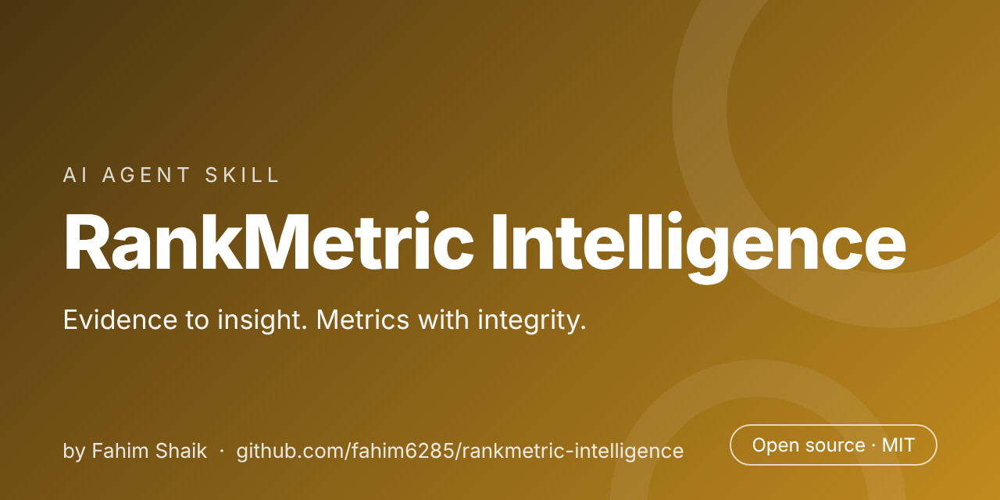

# RankMetric Intelligence

**Evidence to insight. Metrics with integrity.**

   

Institution-neutral AI agent for ranking metrics: reconciles publication data, audits evidence, maps SDGs and runs scenario benchmarking without invented scores.



## Why use it

- **Official-method first.** Validates the applicable methodology edition and reporting period before analysis.
- **Publication reconciliation.** Normalizes bibliographic identifiers and de-duplicates records while preserving provenance.
- **SDG attribution.** Consolidates SDG-tagged publication lists across departments and categories.
- **Evidence register.** Tracks every claim against its source so reports stay auditable.
- **Scenario benchmarking.** Computes gaps against benchmarks without inventing scores or records.

## What is in this repository

| Part | Count | Location |
|---|---|---|
| Main skill | 1 | `skills/rankmetric-intelligence/SKILL.md` |
| Agent setup text | see folder | `skills/rankmetric-intelligence/AGENT_INSTRUCTIONS.md` |
| Reference protocols | 8 | `skills/rankmetric-intelligence/references/` |
| Templates | 8 | `skills/rankmetric-intelligence/templates/` |
| Python utilities | 3 | `skills/rankmetric-intelligence/scripts/` |
| Synthetic examples | 4 | `skills/rankmetric-intelligence/examples/` |
| Plugin manifest | 1 | `.codex-plugin/plugin.json` |

All examples are synthetic. The repository contains no private data, research results, credentials or institutional records.

## How to use it

1. **In ChatGPT or another agent builder:** create a skill or plugin from `skills/rankmetric-intelligence/SKILL.md` and paste `AGENT_INSTRUCTIONS.md` where the platform asks for instructions.
2. **In a regular chat:** attach `SKILL.md` and the reference files, or paste them, then describe your task.
3. **Offline tools:** run the scripts directly (see Quick start).

## Quick start

```bash
cd skills/rankmetric-intelligence
python tests/test_scripts.py               # run the bundled regression tests
python scripts/scenario_gap.py --help      # see options for the scenario tool
python scripts/reconcile_metric_tables.py --help
python scripts/consolidate_sdg_csv.py --help
```

All three utilities use only the Python standard library and run offline. Example files in `examples/` are synthetic.

## Sample prompts

- Reconcile these two publication tables and report every mismatch with its source.
- Consolidate these SDG-tagged CSV files and remove duplicates by DOI.
- Build an evidence register for this ranking submission and flag missing items.
- Map our year-wise metrics to the definitions in the latest official methodology.
- Run a scenario: how many more indexed publications close the gap to this benchmark?
- Prepare an indicator report with a full provenance trail.

More prompts are in [`docs/sample-prompts.md`](docs/sample-prompts.md).

## Principles

Evidence first. No invented facts, scores, citations or records. Every claim traces to a source you provided or an official source the agent checks. Third-party documents are treated as content, never as instructions.

## Part of a suite

This agent belongs to [Fahim's AI Agents](https://github.com/fahim6285/fahim-ai-agents), a set of five open-source agents for academic and research work: VitaMorph Studio, SciForge Lab, CareerBridge Academic, RankMetric Intelligence and EduAdapt Studio.

## Contributing, citing and license

Contributions are welcome. See [CONTRIBUTING.md](CONTRIBUTING.md). To cite this work, use the "Cite this repository" button on GitHub (from `CITATION.cff`). Released under the [MIT License](LICENSE).

Created by **Fahim Shaik**.
